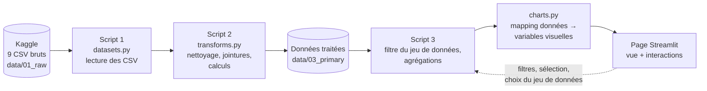

# Documentation du projet — Olist DataViz

Projet MBDS de visualisation d'information (Marco Winckler).
Données : [Brazilian E-Commerce Public Dataset by Olist (Kaggle)](https://www.kaggle.com/datasets/olistbr/brazilian-ecommerce).

> Les CSV bruts ne sont pas dans le dépôt : on pointe vers la source Kaggle.
> Les données **traitées** utilisées par l'application sont dans `data/03_primary/`,
> et les **scripts** qui les produisent sont dans `src/mbds_projet_dataviz/domains/`.

## 1. Description du projet

Olist est une place de marché brésilienne : de petits vendeurs y publient leurs
produits et Olist organise la livraison. Le jeu de données Kaggle contient environ
**100 000 commandes réelles** (anonymisées) passées entre **2016 et 2018**, réparties
dans 9 tables reliées par des identifiants : commandes, articles, paiements, avis,
clients, vendeurs, produits, géolocalisation et traduction des catégories. Il est
**multivarié** : il mélange des attributs quantitatifs (prix, frais de port, délai),
ordinaux (note de 1 à 5), catégoriels (état, catégorie, type de paiement),
temporels (dates) et géographiques (état, coordonnées).

Notre application Streamlit raconte une seule histoire en quatre pages, chacune
construite autour d'une technique de visualisation et d'une hypothèse :
**où** les livraisons sont lentes (carte), **quand** les retards apparaissent
(série temporelle), **quel effet** ils ont sur les avis (coordonnées parallèles)
et **quelles catégories** sont touchées (treemap). Chaque vue propose une vue
d'ensemble et un niveau de détail, des interactions (sélection, filtres, zoom) et
un sélecteur de jeu de données (2017, 2018, toutes les commandes).

## 2. Utilisateurs visés et leurs tâches

**Utilisateurs principaux :** les analystes de la place de marché Olist
(responsables de catégories, logistique, service client). Ils connaissent le
métier, pas la programmation, et veulent repérer où se concentrent les ventes,
les retards et les mauvais avis.
**Utilisateurs secondaires :** les vendeurs, qui veulent se comparer à leur région
et à leur catégorie.

| Besoin (but) | Tâche de l'utilisateur dans l'outil | Vue |
|---|---|---|
| Savoir où sont la demande et les problèmes | Comparer les états (chiffre d'affaires, retards, notes), zoomer sur un état | Carte |
| Comprendre les tendances et la saisonnalité | Trouver les pics (Black Friday 2017), zoomer sur une période | Série temporelle |
| Trouver ce qui provoque les mauvais avis | Filtrer les commandes par délai, prix, frais et voir les notes qui restent | Coordonnées parallèles |
| Savoir quelles catégories comptent | Classer les catégories par chiffre d'affaires, zoomer d'un groupe à une catégorie | Treemap |

Avec le vocabulaire du cours : *overview, zoom, filter, details on demand*
(Shneiderman) ; *découvrir, comparer, résumer, corréler* (Munzner).

## 3. Pipeline de visualisation (workflow)

Chaque domaine (page) suit la même chaîne : `datasets.py` (choix et lecture des
données) → `transforms.py` (nettoyage, jointures, indicateurs) → `charts.py`
(mapping visuel) → `pages/<domaine>.py` (affichage, filtres, interprétation).
Les interactions de l'utilisateur reviennent sur les étapes de filtrage et
d'agrégation, et la vue est redessinée.

### Structure de l'application et du code

Lancer l'application : `streamlit run main.py`. Le menu de gauche affiche
l'accueil puis les 4 pages, dans l'ordre de l'histoire.

| Page du menu | Fichier de la page | Code des données et graphiques | Membre |
|---|---|---|---|
| Accueil | `pages/about.py` | — | 3 |
| 1. Où ? Carte des retards | `pages/carte.py` | `domains/livraison/` | 1 |
| 2. Quand ? Évolution | `pages/temps.py` | `domains/temps/` | 2 |
| 3. Quel effet ? Retards et avis | `pages/coordonnees.py` | `domains/coordonnees/` | 3 |
| 4. Quelles catégories ? | `pages/treemap.py` | `domains/treemap/` | 4 |

Chaque page suit la même structure : **question → vue d'ensemble → détail →
réponse → lien vers la page suivante**.

## 4. Les visualisations

Pour chaque visualisation : **à quoi ça sert**, le **mapping données → variables
visuelles** et l'**interaction**.

### 4.1 Carte — membre 1

**À quoi ça sert.** Tester l'hypothèse : *« les clients du Nord et du Nordeste
attendent plus longtemps et subissent plus de retards que ceux du Sudeste, parce
que la majorité des vendeurs se trouve dans l'État de São Paulo »*. L'utilisateur
(responsable logistique) cherche **où** les livraisons sont lentes, et **si la
distance au vendeur suffit à l'expliquer**.

**Pipeline du domaine** (`src/mbds_projet_dataviz/domains/livraison/`) :

| Étape | Script | Ce qui est fait |
|---|---|---|
| 1 | `datasets.py` | Lecture de la table `orders` (pipeline commun), des vendeurs et du GeoJSON des 27 États ; commandes livrées seulement |
| 2 | `shared/pipeline.py` + `transforms.py` | Géolocalisation moyennée par préfixe de code postal, distance à vol d'oiseau client ↔ vendeur principal (haversine) ; indicateurs par État et région (délai médian, retard, note, CA, part de vendeurs locaux) ; intervalles de confiance (médiane exacte, Wilson) ; régression du délai sur la région, sans puis avec la distance (part de l'écart expliquée) |
| 3 | `transforms.routes_to_state`, `state_distance_profile`, `region_gaps` | Itinéraires ville du vendeur → clients d'un État, délai par tranche de distance, écart au Sudeste brut puis à distance égale |

Reconstruire les données : `python -m mbds_projet_dataviz.shared.pipeline --raw-dir <dossier_csv>`.

**Mapping données → variables visuelles**

| Donnée | Type | Variable visuelle |
|---|---|---|
| Indicateur choisi par État (délai, retard, note, CA, part locale) | quantitatif | **couleur** d'un État (rampe bleue séquentielle, clair = faible, foncé = élevé) |
| Indicateur par région | quantitatif | **longueur** d'une barre horizontale |
| Itinéraire vendeur → clients (détail d'un État) | item | un **arc** ; **épaisseur** = nombre de commandes, **couleur** = délai médian (échelle fixe, comparable d'un État à l'autre) |
| Ville du vendeur / point moyen des clients | géographique | **position** (losange orange = vendeur, point = clients) |
| Délai par tranche de distance | quantitatif | **position** sur une courbe + barres d'IC à 95 % |
| Écart de délai au Sudeste (brut / à distance égale) | quantitatif | **longueur** de deux barres groupées |

**Deux niveaux (overview + détail)**

- *Overview* : carte choroplèthe des 27 États + barres par région. L'utilisateur
  voit d'un coup d'œil le gradient Nord → Sud.
- *Détail* : pour un État choisi, la carte des itinéraires (d'où viennent les
  colis) et la courbe délai selon la distance, qui isole l'effet de la distance
  **à l'intérieur d'un même État**.

**Interactions**

- **Clic sur un État** de la carte → ouvre son détail plus bas (lien entre les
  deux niveaux) ; un sélecteur d'État fait la même chose.
- **Choix de l'indicateur** affiché sur la carte (délai, retard, note, CA, part
  de vendeurs du même État).
- **Survol** (*details on demand*) : chaque État, arc, ville ou tranche de
  distance affiche ses chiffres (commandes, distance, délai, retard).
- **Section robustesse** : intervalles de confiance par région et décomposition
  de l'écart (brut vs à distance égale), pour distinguer un écart réel d'un effet
  de distance.
- **Changement de jeu de données** (2017, 2018, toutes les commandes).

**Résultat : hypothèse confirmée en partie** (toutes les commandes) :

- délai médian **20,2 jours** au Norte et **17,3** au Nordeste, contre **8,7** au
  Sudeste (intervalles de confiance disjoints) ;
- la distance au vendeur explique environ **49 %** de l'écart du Norte et **56 %**
  de celui du Nordeste ; à distance égale, il reste **+6 jours** (Norte) et
  **+4 jours** (Nordeste) ;
- pour les retards, l'excès du Norte disparaît à distance égale (la date estimée
  tient déjà compte de la distance), mais celui du Nordeste persiste (**+4,4
  points**) : la distance ne suffit pas.

**Limites.** Données observationnelles : les vendeurs choisissent où s'installer,
donc on montre une association, pas une preuve de cause. La distance est à vol
d'oiseau et ignore le transporteur et l'itinéraire réel. Le Norte compte peu de
commandes et presque aucun vendeur local dans les données.

### 4.2 Série temporelle — membre 2

**À quoi ça sert.** Tester l'hypothèse : *« le Black Friday du 24 novembre 2017
crée le plus grand pic de commandes, et les livraisons en retard augmentent dans
les semaines qui suivent »*. L'utilisateur cherche **quand** la demande et les
retards montent, et si les pics de commandes expliquent les pics de retard.

**Pipeline du domaine** (`src/mbds_projet_dataviz/domains/temps/`) :

| Étape | Script | Ce qui est fait |
|---|---|---|
| 1 | `datasets.py` | Lecture de la table `orders` (pipeline commun) : date d'achat et retard, toutes les commandes passées |
| 2 | `transforms.time_series` | Agrégation par jour / semaine / mois : nombre de commandes et taux de retard (masqué sous 30 commandes livrées) |
| 3 | `transforms.black_friday_test`, `weekly_points`, `same_volume_contrast` | Test Black Friday (pic de commandes, retard avant/après avec IC de Wilson), semaines mises en avant, mois le plus en retard comparé à un mois de même volume |

**Mapping données → variables visuelles**

| Donnée | Type | Variable visuelle |
|---|---|---|
| Commandes par période | quantitatif | **position** sur une courbe (panneau haut) |
| Taux de retard par période | quantitatif | **position** sur une courbe (panneau bas, même axe de temps) |
| Black Friday (24/11/2017) | événement | **ligne verticale** repère |
| Semaine (commandes, retard) | item | **position** d'un point (commandes en x, retard en y) |
| Rôle d'une semaine | catégoriel | **couleur** du point (orange = pic de commandes, bleu = semaines les plus en retard, gris = autres) |
| Retard avant / après Black Friday | quantitatif | **longueur** de barre + barres d'IC à 95 % |

**Deux niveaux (overview + détail)**

- *Overview* (focus + contexte) : deux courbes superposées sur le même axe de
  temps, avec un **curseur de zoom** en bas pour resserrer la fenêtre ; les deux
  panneaux suivent ensemble. Jamais de double axe : les deux mesures d'échelles
  différentes restent dans deux panneaux séparés.
- *Détail* : comparaison avant/après Black Friday, et nuage « une semaine par
  point » qui confronte volume et retard.

**Interactions**

- **Pas de temps** : basculer entre jour, semaine et mois.
- **Zoom** (*focus + context*) : faire glisser les poignées du bandeau du bas
  pour resserrer la période ; les deux courbes se redessinent.
- **Survol** (*details on demand*) : chaque point affiche la période, le nombre
  de commandes et le taux de retard.
- **Changement de jeu de données** (2017, 2018, toutes les commandes).

**Résultat : hypothèse confirmée** (toutes les commandes) :

- le pic de commandes est bien le **24/11/2017** (1 176 commandes, 2,4 fois le
  deuxième jour le plus chargé) ;
- le taux de retard passe de **4,2 %** en octobre 2017 à **11,3 %** dans les 28
  jours après Black Friday (intervalles de confiance disjoints) ;
- **mais ce n'est pas la pire période** : mars 2018 atteint **19,0 %** de retards
  avec un volume comparable à janvier 2018 (5,7 %), donc le volume n'explique
  qu'une partie des retards — une autre cause (logistique, transporteurs) joue.

**Limites.** La date est celle de l'**achat** : un retard est rattaché au jour de
commande, pas au jour de livraison. Les données ne disent pas *pourquoi* un colis
est en retard : la série montre quand, pas la cause.

### 4.3 Coordonnées parallèles — membre 3

**À quoi ça sert.** Tester l'hypothèse : *« c'est le retard de livraison, et non
le prix ou les frais de port, qui explique les avis à 1 ou 2 étoiles »*.
L'utilisateur (responsable service client ou logistique) cherche **quels
attributs varient avec la note**, pour savoir où agir.

**Pipeline du domaine** (`src/mbds_projet_dataviz/domains/coordonnees/`) :

| Étape | Script | Ce qui est fait |
|---|---|---|
| 1 | `datasets.py` | Lecture de 7 CSV : commandes, articles, produits, traduction, paiements, avis, clients |
| 2 | `transforms.build_orders` | Commandes livrées seulement ; prix et frais = somme des articles ; catégorie du 1er article ; avis le plus récent ; délai = livraison − achat ; retard = jour de livraison après le jour promis → **95 824 commandes** dans `data/03_primary/coordonnees/orders.parquet` |
| 3 | `transforms.filter_dataset`, `category_summary`, `sample_orders` | Filtre de période (2017 / 2018 / tout), moyennes par catégorie (≥ 30 commandes), échantillon de 2 000 commandes pour le dessin du détail |

Reconstruire les données : `python -m mbds_projet_dataviz.domains.coordonnees.transforms <dossier_csv>`.

**Mapping données → variables visuelles**

| Donnée | Type | Variable visuelle |
|---|---|---|
| Prix, frais de port, poids (R$, kg) | quantitatif | **position** sur un axe vertical (échelle log) |
| Délai de livraison, retard (jours) | quantitatif | **position** sur un axe vertical |
| Mensualités | quantitatif | **position** sur un axe vertical |
| Note du client (1 à 5) | ordinal | **position** sur son axe + **couleur** de la ligne en 3 classes : rouge = note 1-2, gris = 3, bleu = 4-5 |
| Catégorie (overview) / commande (détail) | item | une **ligne** qui traverse tous les axes |

**Deux niveaux (overview + détail)**

- *Overview* : une ligne par **catégorie** (moyennes). Couleur = note moyenne en 3 classes : rouge = mal notée (< 4,0), gris = dans la moyenne (4,0 à 4,3), bleu = bien notée (≥ 4,3).
- *Détail* : une ligne par **commande** des catégories choisies. Couleur = note (rouge = 1-2, gris = 3, bleu = 4-5) ; hors sélection = très pâle ; bande jaune = plage sélectionnée.

**Interactions**

- **Survol** (*details on demand*) : passer la souris sur une ligne de l'overview
  affiche la catégorie et ses chiffres.
- **Sélection** des catégories à détailler ; elles sont **surlignées** dans
  l'overview (lien entre les deux niveaux).
- **Brushing** avec des curseurs (note, livraison, prix, frais) : les commandes
  dans la plage restent en couleur, les autres deviennent très pâles, et une bande jaune
  marque la plage sur l'axe. Les chiffres de la sélection sont recalculés sur
  toutes les commandes des catégories choisies.
- **Sélection rapide** pour la démo : avis 1-2 ★, prix élevés, frais élevés,
  livraison longue.
- **Réorganiser** les axes (« Ordre des axes »).
- **Aide à la lecture** : légende des couleurs sur chaque graphique, bulles
  d'aide (?) à côté des titres, définition de chaque axe au survol de son titre
  et dans « Définition de chaque axe ».
- **Changement de jeu de données** (2017, 2018, toutes les commandes).

**Présentation (tableau de bord, même style que la page 4)** : quatre chiffres
clés en haut, puis trois cadres (vue d'ensemble, détail, réponse), noms de
catégories en français, et « À propos des chiffres » pour la source et les
limites.

Le graphique est dessiné en SVG (sans WebGL) pour s'afficher dans tous les
navigateurs.

**Résultat : hypothèse confirmée** (toutes les commandes) :

- livrée **en retard** → **62 %** d'avis à 1-2 étoiles, contre **9 %** à l'heure ;
- les avis 1-2 étoiles ont une livraison médiane de **16 jours**, contre 10 ;
- corrélation (Spearman) de la note avec le délai : **−0,23**, contre −0,03 avec
  le prix et −0,09 avec les frais de port ;
- même conclusion sur 2017 et sur 2018.

**Limites.** Corrélation n'est pas causalité (des frais élevés vont souvent avec
des envois lointains, donc plus longs) ; la catégorie est celle du premier
article ; seules les commandes livrées et notées sont prises en compte.

### 4.4 Treemap — membre 4

**À quoi ça sert.** Répondre à la question métier : *« quelles catégories examiner
en premier pour réduire les avis négatifs ? »*. Hypothèse : *les meilleures ventes
ne sont pas nécessairement les catégories avec la plus forte proportion d'avis
négatifs*. L'utilisateur (responsable de catégories) veut distinguer **volume des
problèmes, fréquence et poids dans les ventes**, sans score opaque.

**Pipeline du domaine** (`src/mbds_projet_dataviz/domains/treemap/`) :

| Étape | Script | Ce qui est fait |
|---|---|---|
| 1 | `datasets.py` | Réutilise la table préparée de la page 3 (`data/03_primary/coordonnees/orders.parquet`), même population : commandes livrées et notées |
| 2 | `transforms.prepare_orders`, `summarize`, `hierarchy` | Regroupement éditorial des catégories en familles (`GROUPS`), CA additif (somme des prix, hors port), note et taux calculés par commande (pas de moyenne de moyennes), hiérarchie total → groupe → catégorie |
| 3 | `transforms.filter_scope`, `priorities`, `key_numbers` | Filtre de famille et d'effectif minimum, classement des catégories prioritaires (taux d'avis négatifs au-dessus de la moyenne Olist, triées par nombre réel d'avis négatifs) |

Reconstruire les données : `python -m mbds_projet_dataviz.domains.coordonnees.transforms <dossier_csv>`.

**Mapping données → variables visuelles**

| Donnée | Type | Variable visuelle |
|---|---|---|
| Chiffre d'affaires d'une catégorie / famille | quantitatif | **aire** d'un rectangle du treemap |
| Appartenance catégorie → famille → total | hiérarchique | **imbrication** des rectangles |
| Indicateur de couleur (avis négatifs, retard ou note) | quantitatif | **couleur** du rectangle (rampe ; rouge = mauvais) |
| Classement d'une catégorie (avis négatifs, part, ventes) | quantitatif | **longueur** de barre horizontale |
| Avis négatifs selon la livraison (à l'heure / en retard) | quantitatif | **longueur** de deux barres |

**Deux niveaux (overview + détail)**

- *Overview* : treemap des familles et catégories (aire = ventes, couleur = part
  d'avis négatifs) + classement des 10 premières catégories.
- *Détail* : pour une catégorie choisie, ses chiffres clés (ventes, avis
  négatifs vs moyenne Olist) et la comparaison des avis négatifs entre livraisons
  à l'heure et en retard.

**Interactions**

- **Zoom hiérarchique** : cliquer sur une famille du treemap descend à ses
  catégories (barre de chemin pour remonter).
- **Filtres** : famille de produits, nombre minimum de commandes par catégorie,
  indicateur de couleur.
- **Sélection d'une catégorie** (clic sur une barre ou menu) → met à jour le
  détail.
- **Classement** des catégories selon la mesure choisie (nombre d'avis négatifs,
  part, ventes).
- **Survol** (*details on demand*) : ventes, commandes, avis négatifs, retard et
  note de chaque rectangle.
- **Export** des chiffres par catégorie et **changement de jeu de données**
  (2017, 2018, toutes les commandes).

**Résultat.** Les catégories qui concentrent le plus d'avis négatifs (linge de
maison, accessoires informatiques, meubles et décoration) ne sont pas toujours les
plus en retard : leur taux de retard reste proche de la moyenne Olist. Le volume
d'avis négatifs vient donc surtout de leur **gros volume de ventes** ; agir sur la
seule livraison n'y suffirait pas, le produit lui-même est à examiner.

**Limites.** Les familles sont un choix de présentation, pas une nomenclature
d'Olist. La commande entière est attribuée à la catégorie de son premier article.
Le nombre d'avis négatifs observés n'est ni un nombre d'avis évitables ni des
ventes perdues.
