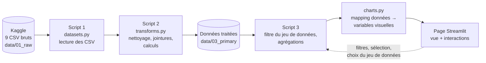
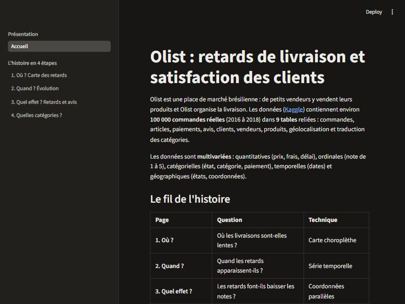
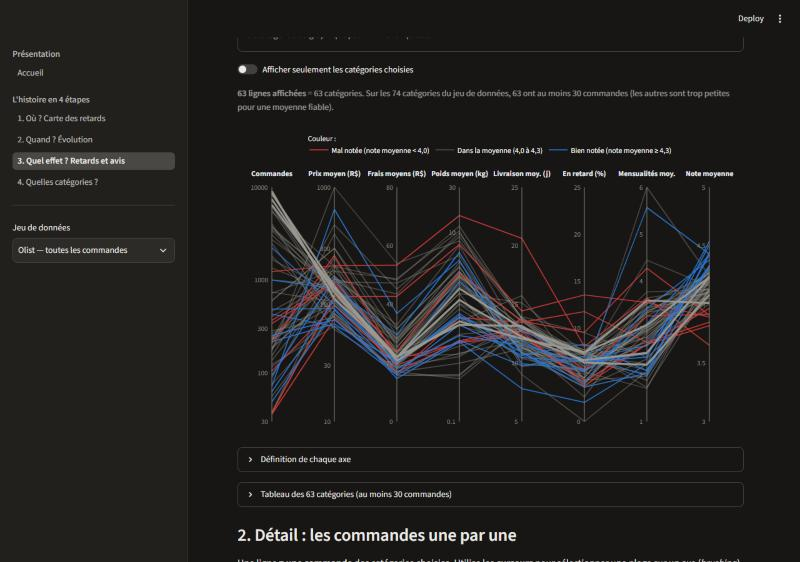
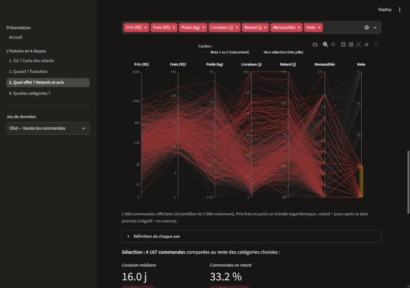
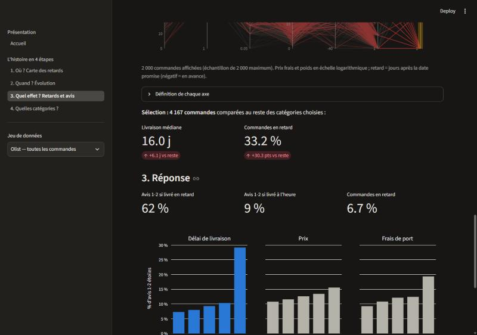

# Documentation du projet — Olist DataViz

Projet MBDS de visualisation d'information (Marco Winckler).
Données : [Brazilian E-Commerce Public Dataset by Olist (Kaggle)](https://www.kaggle.com/datasets/olistbr/brazilian-ecommerce).

> Les CSV bruts ne sont pas dans le dépôt : on pointe vers la source Kaggle.
> Les données **traitées** utilisées par l'application sont dans `data/03_primary/`,
> et les **scripts** qui les produisent sont dans `src/mbds_projet_dataviz/domains/`.

## 1. Description du projet

Olist est une place de marché brésilienne : de petits vendeurs y publient leurs
produits et Olist organise la livraison. Le jeu de données Kaggle contient environ
**100 000 commandes réelles** (anonymisées) passées entre **2016 et 2018**, réparties
dans 9 tables reliées par des identifiants : commandes, articles, paiements, avis,
clients, vendeurs, produits, géolocalisation et traduction des catégories. Il est
**multivarié** : il mélange des attributs quantitatifs (prix, frais de port, délai),
ordinaux (note de 1 à 5), catégoriels (état, catégorie, type de paiement),
temporels (dates) et géographiques (état, coordonnées).

Notre application Streamlit raconte une seule histoire en quatre pages, chacune
construite autour d'une technique de visualisation et d'une hypothèse :
**où** les livraisons sont lentes (carte), **quand** les retards apparaissent
(série temporelle), **quel effet** ils ont sur les avis (coordonnées parallèles)
et **quelles catégories** sont touchées (treemap). Chaque vue propose une vue
d'ensemble et un niveau de détail, des interactions (sélection, filtres, zoom) et
un sélecteur de jeu de données (2017, 2018, toutes les commandes).

## 2. Utilisateurs visés et leurs tâches

**Utilisateurs principaux :** les analystes de la place de marché Olist
(responsables de catégories, logistique, service client). Ils connaissent le
métier, pas la programmation, et veulent repérer où se concentrent les ventes,
les retards et les mauvais avis.
**Utilisateurs secondaires :** les vendeurs, qui veulent se comparer à leur région
et à leur catégorie.

| Besoin (but) | Tâche de l'utilisateur dans l'outil | Vue |
|---|---|---|
| Savoir où sont la demande et les problèmes | Comparer les états (chiffre d'affaires, retards, notes), zoomer sur un état | Carte |
| Comprendre les tendances et la saisonnalité | Trouver les pics (Black Friday 2017), zoomer sur une période | Série temporelle |
| Trouver ce qui provoque les mauvais avis | Filtrer les commandes par délai, prix, frais et voir les notes qui restent | Coordonnées parallèles |
| Savoir quelles catégories comptent | Classer les catégories par chiffre d'affaires, zoomer d'un groupe à une catégorie | Treemap |

Avec le vocabulaire du cours : *overview, zoom, filter, details on demand*
(Shneiderman) ; *découvrir, comparer, résumer, corréler* (Munzner).

## 3. Pipeline de visualisation (workflow)

Chaque domaine (page) suit la même chaîne : `datasets.py` (choix et lecture des
données) → `transforms.py` (nettoyage, jointures, indicateurs) → `charts.py`
(mapping visuel) → `pages/<domaine>.py` (affichage, filtres, interprétation).
Les interactions de l'utilisateur reviennent sur les étapes de filtrage et
d'agrégation, et la vue est redessinée.

### Structure de l'application et du code

Lancer l'application : `streamlit run main.py`. Le menu de gauche affiche
l'accueil puis les 4 pages, dans l'ordre de l'histoire.

| Page du menu | Fichier de la page | Code des données et graphiques | Membre |
|---|---|---|---|
| Accueil | `pages/about.py` | — | 3 |
| 1. Où ? Carte des retards | `pages/carte.py` | `domains/carte/` | 1 |
| 2. Quand ? Évolution | `pages/temps.py` | `domains/temps/` | 2 |
| 3. Quel effet ? Retards et avis | `pages/coordonnees.py` | `domains/coordonnees/` | 3 |
| 4. Quelles catégories ? | `pages/treemap.py` | `domains/treemap/` | 4 |

Chaque page suit la même structure : **question → vue d'ensemble → détail →
réponse → lien vers la page suivante**.

## 4. Les visualisations

Pour chaque visualisation : **à quoi ça sert**, le **mapping données → variables
visuelles** et l'**interaction**, et une **capture d'écran**.

### 4.1 Carte — membre 1

*À compléter par le membre 1 (même plan que la partie 4.3).*

### 4.2 Série temporelle — membre 2

*À compléter par le membre 2 (même plan que la partie 4.3).*

### 4.3 Coordonnées parallèles — membre 3

**À quoi ça sert.** Tester l'hypothèse : *« c'est le retard de livraison, et non
le prix ou les frais de port, qui explique les avis à 1 ou 2 étoiles »*.
L'utilisateur (responsable service client ou logistique) cherche **quels
attributs varient avec la note**, pour savoir où agir.

**Pipeline du domaine** (`src/mbds_projet_dataviz/domains/coordonnees/`) :

| Étape | Script | Ce qui est fait |
|---|---|---|
| 1 | `datasets.py` | Lecture de 7 CSV : commandes, articles, produits, traduction, paiements, avis, clients |
| 2 | `transforms.build_orders` | Commandes livrées seulement ; prix et frais = somme des articles ; catégorie du 1er article ; avis le plus récent ; délai = livraison − achat ; retard = jour de livraison après le jour promis → **95 824 commandes** dans `data/03_primary/coordonnees/orders.parquet` |
| 3 | `transforms.filter_dataset`, `category_summary`, `sample_orders` | Filtre de période (2017 / 2018 / tout), moyennes par catégorie (≥ 30 commandes), échantillon de 2 000 commandes pour le dessin du détail |

Reconstruire les données : `python -m mbds_projet_dataviz.domains.coordonnees.transforms <dossier_csv>`.

**Mapping données → variables visuelles**

| Donnée | Type | Variable visuelle |
|---|---|---|
| Prix, frais de port, poids (R$, kg) | quantitatif | **position** sur un axe vertical (échelle log) |
| Délai de livraison, retard (jours) | quantitatif | **position** sur un axe vertical |
| Mensualités | quantitatif | **position** sur un axe vertical |
| Note du client (1 à 5) | ordinal | **position** sur son axe + **couleur** de la ligne en 3 classes : rouge = note 1-2, gris = 3, bleu = 4-5 |
| Catégorie (overview) / commande (détail) | item | une **ligne** qui traverse tous les axes |

**Deux niveaux (overview + détail)**

- *Overview* : une ligne par **catégorie** (moyennes). Couleur = note moyenne en 3 classes : rouge = mal notée (< 4,0), gris = dans la moyenne (4,0 à 4,3), bleu = bien notée (≥ 4,3).
- *Détail* : une ligne par **commande** des catégories choisies. Couleur = note (rouge = 1-2, gris = 3, bleu = 4-5) ; hors sélection = très pâle ; bande jaune = plage sélectionnée.

**Interactions**

- **Survol** (*details on demand*) : passer la souris sur une ligne de l'overview
  affiche la catégorie et ses chiffres.
- **Sélection** des catégories à détailler ; elles sont **surlignées** dans
  l'overview (lien entre les deux niveaux).
- **Brushing** avec des curseurs (note, livraison, prix, frais) : les commandes
  dans la plage restent en couleur, les autres deviennent très pâles, et une bande jaune
  marque la plage sur l'axe. Les chiffres de la sélection sont recalculés sur
  toutes les commandes des catégories choisies.
- **Sélection rapide** pour la démo : avis 1-2 ★, prix élevés, frais élevés,
  livraison longue.
- **Réorganiser** les axes (« Ordre des axes »).
- **Aide à la lecture** : légende des couleurs sur chaque graphique, bulles
  d'aide (?) à côté des titres, définition de chaque axe au survol de son titre
  et dans « Définition de chaque axe ».
- **Changement de jeu de données** (2017, 2018, toutes les commandes).

**Présentation (tableau de bord, même style que la page 4)** : quatre chiffres
clés en haut, puis trois cadres (vue d'ensemble, détail, réponse), noms de
catégories en français, et « À propos des chiffres » pour la source et les
limites.

Le graphique est dessiné en SVG (sans WebGL) pour s'afficher dans tous les
navigateurs.

**Captures d'écran**

**Résultat : hypothèse confirmée** (toutes les commandes) :

- livrée **en retard** → **62 %** d'avis à 1-2 étoiles, contre **9 %** à l'heure ;
- les avis 1-2 étoiles ont une livraison médiane de **16 jours**, contre 10 ;
- corrélation (Spearman) de la note avec le délai : **−0,23**, contre −0,03 avec
  le prix et −0,09 avec les frais de port ;
- même conclusion sur 2017 et sur 2018.

**Limites.** Corrélation n'est pas causalité (des frais élevés vont souvent avec
des envois lointains, donc plus longs) ; la catégorie est celle du premier
article ; seules les commandes livrées et notées sont prises en compte.

### 4.4 Treemap — membre 4

*À compléter par le membre 4 (même plan que la partie 4.3).*
